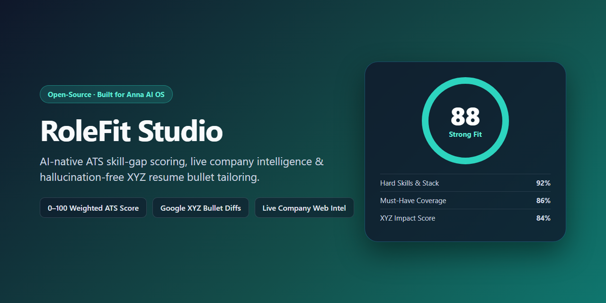
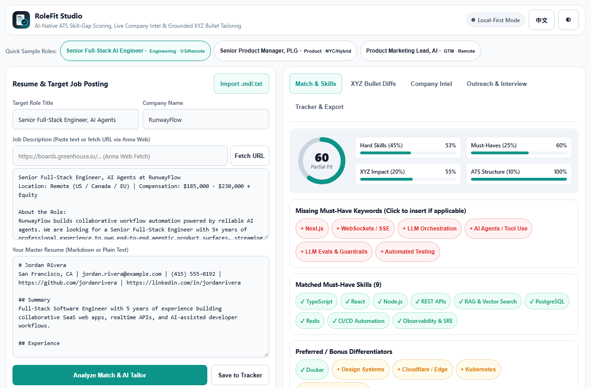

# RoleFit Studio

<p align="center">
  
</p>

<p align="center">
  <strong>AI-Native ATS Resume &amp; Job-Match Studio — Deterministic Skill-Gap Scoring, Live Company Intel &amp; Grounded XYZ Bullet Tailoring</strong>
</p>

<p align="center">
  <a href="./README.zh-CN.md">简体中文文档</a> ·
  <a href="https://anna.partners">Built for Anna AI OS</a> ·
  <a href="./LICENSE">MIT License</a>
</p>

---

**RoleFit Studio** is an open-source, privacy-first career workbench built for modern job seekers, engineers, product managers, and GTM operators. Instead of paying $49/month for black-box ATS scanners or pasting your resume into generic chatbots that hallucinate fake employers and numbers, RoleFit Studio combines a **deterministic zero-dependency ATS & Google-XYZ scoring engine** with **Anna AI OS's Host LLM, live Web Search, and Persistent Storage** — requiring **zero API keys** and **zero backend setup**.



## Why RoleFit Studio?

1. **Transparent Weighted ATS Match Score (`0–100`)**
   - **Hard Skills & Tech Stack (`45%`)**: Canonical skill taxonomy with alias normalization (`k8s` ↔ `Kubernetes`, `postgres` ↔ `PostgreSQL`, `nextjs` ↔ `Next.js`, `PLG`, `RAG`, `CI/CD`, `A/B Testing`, etc.) plus dynamic domain keyword extraction.
   - **Must-Have vs. Nice-to-Have Separation (`25%`)**: Parses JD structure so missing a core requirement weighs `2.2×` more than a bonus skill.
   - **Google XYZ Bullet Quantification (`20%`)**: Audits every experience bullet on *Accomplished [X] as measured by [Y], by doing [Z]* — catching weak passive openers (`"Responsible for"`, `"Worked on"`), missing metrics, clichés, and run-on length.
   - **ATS Structural & Seniority Readiness (`10%`)**: Verifies parser-safe headings (`Summary`, `Experience`, `Skills`, `Education`), contact completeness, and years-of-experience alignment.

2. **Hallucination-Free AI Bullet Diffs (`anna.llm.complete`)**
   - Proposes side-by-side bullet upgrades grounded strictly in your existing resume. Whenever a metric isn't present in your draft, RoleFit inserts explicit `[X%]` or `[N users]` slots rather than fabricating numbers. Click **✓ Apply Rewrite to Resume** to patch the exact line and watch your ATS score update live.

3. **Live Job URL Fetch & Company Intelligence (`anna.web.fetch` + `anna.web.search`)**
   - Paste any public job URL to extract clean JD text, then click **Run Live Company Intel** to research recent product launches, engineering/product culture, and 3 high-signal reverse-interview questions to ask your interviewer.

4. **Hiring Manager Outreach & Interview Rubric**
   - Generates `<110-word` non-cringe Hiring Manager Cold DMs, Cover Hooks, and 5 tailored interview questions mapped to specific story anchors on your resume.

5. **Dual Runtime: Standalone Web + Native Anna AI OS App**
   - Works 100% offline in any browser (`localStorage`), AND ships as a full Schema-4 **Anna AI OS App** bundling:
     - `rolefit-engine` — cross-platform Node.js JSON-RPC 2.0 stdio Executa tool (`analyze_match`, `parse_job_posting`, `audit_bullets`, `export_ats_resume`).
     - `rolefit-coach` — declarative `SKILL.md` for `#rolefit-studio` chat orchestration (`open_app_view` / `update_app_view`).
     - Desktop + Mobile responsive UI (`320px` safe-area & `44×44` touch-target compliant).

## Quickstart (Standalone Local Mode)

```bash
git clone https://github.com/zwhy149/rolefit-studio.git
cd rolefit-studio
npm install
npm run dev
```

Build production web + Anna AI OS bundle & Executa archives:

```bash
npm run build
npm test
```

## Running Inside Anna AI OS

```bash
# Validate manifest, UI bundle & strict Host API surface
anna-app validate --strict --cwd anna-app

# Smoke-test the bundled stdio Executa plugin
cd anna-app/executas/rolefit-engine
anna-app executa dev --describe
anna-app executa dev --health

# Launch local Anna App harness
cd ../..
anna-app dev
```

## Project Layout

```text
rolefit-studio/
├── index.html                 # Standalone web entry
├── src/
│   ├── core/                  # Zero-dependency ATS & XYZ engine (shared with Executa)
│   │   ├── taxonomy.js        # Canonical skills, aliases, action verbs & clichés
│   │   ├── analyzer.js        # JD parser, resume parser, XYZ bullet linter & scorer
│   │   ├── exporter.js        # ATS-safe Markdown, plain text & scorecard formatters
│   │   └── presets.js         # 3 one-click global career presets (SWE, PM, PMM)
│   ├── anna-bridge.js         # Anna App SDK connector + standalone local fallback
│   ├── app.js                 # Interactive 5-tab workbench UI
│   └── style.css              # Light/Dark responsive styles (320px+ mobile ready)
├── anna-app/
│   ├── app.json               # Marketplace listing metadata & bundled executas
│   ├── manifest.json          # Schema-4 Anna App manifest (desktop + mobile)
│   └── executas/
│       ├── rolefit-engine/    # Cross-platform Node.js JSON-RPC 2.0 Executa Tool
│       └── rolefit-coach/     # Declarative SKILL.md for Anna Chat #mentions
├── scripts/
│   └── build-anna-app.mjs     # Syncs Vite bundle + builds POSIX tar.gz & Win zip
└── tests/
    └── core.test.mjs          # Unit + Executa stdio JSON-RPC integration tests
```

## License

Released under the [MIT License](./LICENSE).
