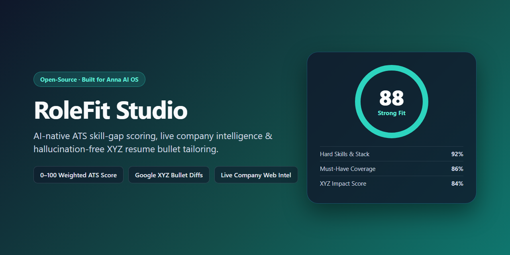

# RoleFit Studio（AI 原生 ATS 简历匹配与岗位情报工作台）

<p align="center">
  
</p>

<p align="center">
  <a href="./README.md">English Documentation</a> ·
  <a href="https://anna.partners">Anna AI OS 原生应用</a> ·
  <a href="./LICENSE">MIT 开源协议</a>
</p>

---

**RoleFit Studio** 是一款面向全球求职者、工程师、产品经理与增长运营人员的开源 **ATS 简历匹配度诊断、实时公司情报调研与真实经历驱动的 XYZ 要点精修工作台**。支持浏览器纯本地离线使用，同时原生接入 **Anna AI OS**（免配置任何第三方 API Key 即可调用宿主大模型、实时网页抓取/搜索与跨端持久化存储）。

## 核心特性

- **四维透明 ATS 匹配度评分（0–100）**：硬技能词库与同义词归一（45%）+ 必备/加分项分层权重（25%）+ Google XYZ 量化影响力诊断（20%）+ ATS 章节结构与年限匹配（10%）。
- **零幻觉 AI 要点精修对比（`anna.llm.complete`）**：基于真实简历内容改写被动句式，缺失数据时使用 `[X%]` 显式槽位而非编造虚假指标，一键应用并实时重算 ATS 分数。
- **招聘链接直抓与实时公司情报（`anna.web.fetch` + `anna.web.search`）**：自动调研目标公司近期产品动态、团队文化与高价值反问面试官问题。
- **Hiring Manager 冷启动内推信 + 5 道定制面试题与故事锚点**。
- **内置跨平台 `rolefit-engine` Executa 工具插件 + `rolefit-coach` 对话技能（Skill）**，支持在 Anna 对话中直接 `#rolefit-studio` 唤起协同窗口。

## 本地快速运行

```bash
git clone https://github.com/zwhy149/rolefit-studio.git
cd rolefit-studio
npm install
npm run build
npm test
```

## 开源协议

本项目基于 [MIT License](./LICENSE) 开源。
